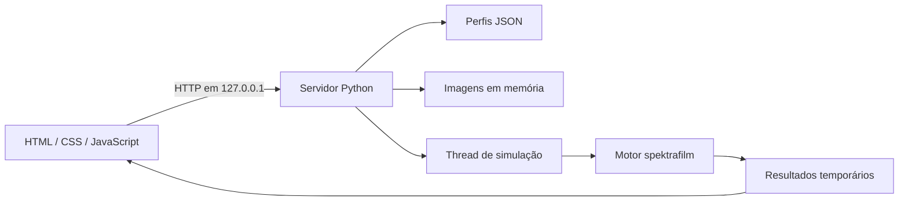

# Arquitetura

A camada web reutiliza o motor incluído no repositório. Ela cuida de arquivos, parâmetros, sessão e apresentação; os modelos físicos permanecem em `spektrafilm`.

## Componentes

| Caminho | Responsabilidade |
| --- | --- |
| `src/spektrafilm_web/server.py` | HTTP, upload, sessão, jobs, mapeamento de parâmetros e exportações |
| `src/spektrafilm_web/static/index.html` | Estrutura e controles da interface |
| `src/spektrafilm_web/static/style.css` | Tema escuro e adaptação do layout |
| `src/spektrafilm_web/static/app.js` | Seleção de perfis, uploads, comparação, polling e downloads |
| `src/spektrafilm` | Motor físico, perfis e utilitários de imagem |
| `src/spektrafilm_gui` | Aplicativo desktop existente |
| `src/spektrafilm_lut_creator` | Ferramentas de LUT existentes |
| `tests/web` | Contratos HTTP e validação dos parâmetros numéricos |

O frontend não exige bundler, framework ou instalação de pacotes JavaScript. O servidor usa `ThreadingHTTPServer` da biblioteca padrão.

## Ciclo de uma imagem

1. O navegador envia os bytes para `POST /api/upload`.
2. O servidor lê a imagem em RGB, atribui um ID e cria uma prévia do original com até 1600 pixels no maior lado.
3. A matriz decodificada fica em `server.images`; o arquivo de upload é removido.
4. O navegador envia o ID e os ajustes para `POST /api/render`.
5. Uma thread chama `init_params` e depois `simulate_preview` ou `simulate`.
6. O navegador consulta `GET /api/jobs/{id}` a cada segundo.
7. Os resultados são disponibilizados em `/media/` para exibição e download.

## Concorrência e estado

Um lock protege a admissão de novas simulações: se houver um job de renderização em execução, outro render recebe HTTP 409. Os estados do job são `running`, `done` e `error`.

Imagens e jobs pertencem ao processo do servidor. Abas compartilham o mesmo estado no backend, embora cada aba mantenha suas próprias seleções no frontend. Não há isolamento de usuários nem expiração por imagem. Reiniciar o processo descarta os registros em memória.

## Progresso

Jobs publicam snapshots com `kind` (`upload` ou `render`), `progress` (0–100), `stage` e `status`. O recebimento do upload é contado pelos bytes lidos; depois há marcos de decodificação, conversão e miniatura. O frontend agrega o progresso dos arquivos em uma importação múltipla.

O callback opcional `on_progress(label, completed, total)` em `Simulator.process`, `simulate` e `simulate_preview` acompanha o início e o fim de cada nó executado da topologia, sem alterar os modelos físicos. Os tempos continuam sendo registrados pelo callback existente. A camada web traduz os rótulos e reserva parte do percentual para preparação e exportação.

Antes de importar ou renderizar, o frontend consulta `/api/health` e confere a versão do protocolo. A sessão retornada permite detectar imagens de um servidor reiniciado. O polling de upload admite até três falhas consecutivas antes de parar de consultar; a resposta do POST continua sendo a fonte de conclusão da importação.

Os percentuais representam etapas, sem estimar duração. O frontend aguarda o carregamento visual do resultado antes de mostrar 100%, cancela o polling de upload ao terminar a requisição e mantém a barra em estado de erro se a operação falhar.

## Estimativa de tempo

`timing.py` mede as transições de etapa e mantém até cinco amostras bem-sucedidas para cada uma de até 32 configurações recentes. A assinatura considera modo, dimensões da origem, filme, papel, espaço/decodificação de entrada e ajustes que afetam grão e propagação de luz. Exposição e filtros de cor não particionam a base. A mediana dos tempos por etapa reduz a influência de execuções mais lentas.

A medição para previsão começa após carregar e validar os parâmetros, antes da preparação do pipeline. O tempo decorrido inclui todo o job, inclusive importações iniciais. Sem amostras comparáveis, não há ETA numérico. Durante a execução, a previsão desconta o tempo da etapa atual e soma as etapas históricas ainda não concluídas. Etapas desconhecidas ou atrasos relevantes mudam o estado para `recalculating`.

O histórico e os relógios são acessados sob o lock do servidor, não persistem em disco e não geram requisições além do polling existente. A API acrescenta `elapsed_seconds`, `remaining_seconds` e `eta_state` aos snapshots de renderização. O frontend distingue a conclusão do backend do carregamento da imagem para exibição.

## Parâmetros

O servidor aplica uma lista explícita de ajustes aos parâmetros do runtime: filme, papel, espaço de entrada, decodificação, exposição, filtros do ampliador, grão, halation e dispersão. A prévia define `settings.preview_mode = True` e `preview_max_size = 1000`. O motor decide quais efeitos esse modo desativa.

## Limites da implementação

O servidor é destinado ao computador local. Não inclui autenticação, HTTPS, persistência ou infraestrutura para publicação na internet. Dependências científicas são importadas quando necessárias: a página e a biblioteca de perfis podem ser servidas sem instalar o motor completo, mas uploads e simulações exigem essas dependências.

O desenho e os endpoints ainda podem mudar durante a validação inicial.
